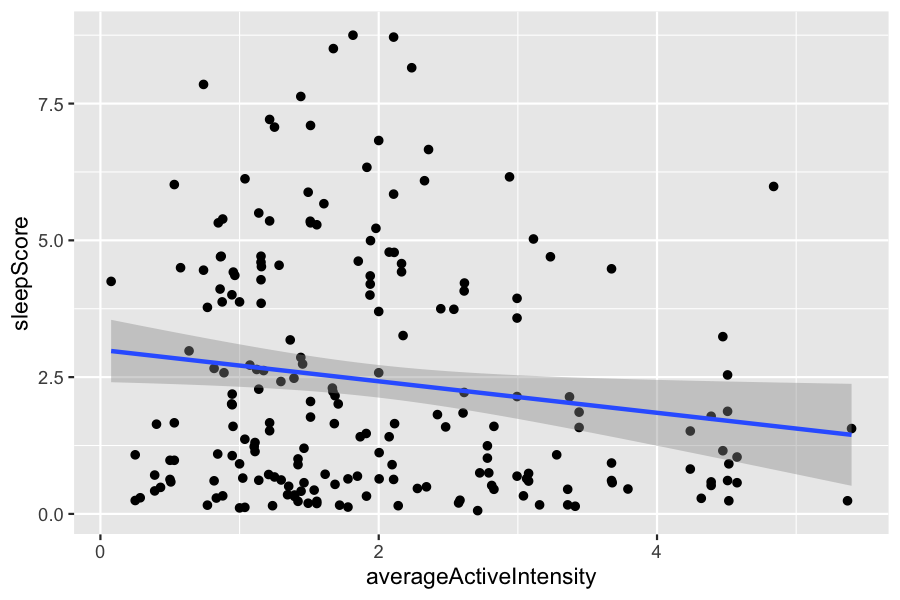
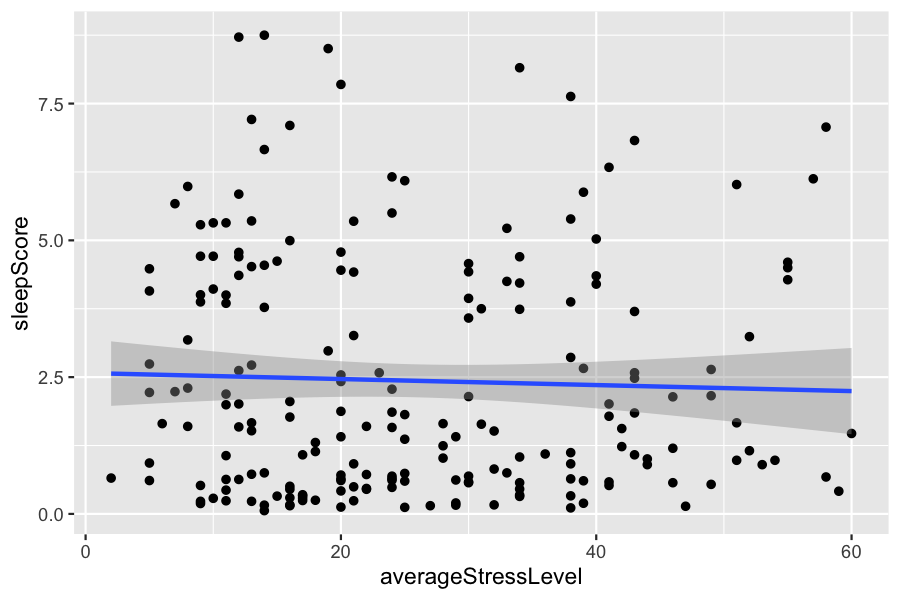
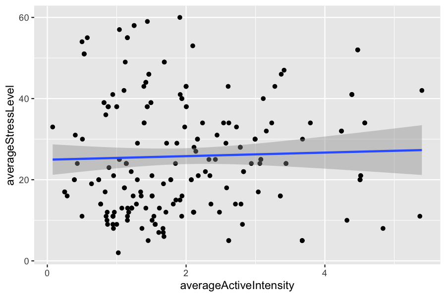

# Garmin Sleep & Stress Analysis

Statistical analysis of Garmin smartwatch data exploring how exercise intensity and stress relate to sleep quality.

## Overview

Wearable devices collect large amounts of daily health data, but it is not always clear how different metrics relate to each other. This project uses Garmin sleep and daily activity records to answer three questions:

1. Is daily stress level associated with sleep quality?
2. Is exercise intensity associated with sleep quality?
3. Is exercise intensity associated with daily stress level?

The data pipeline is written in Python, and the statistical analysis is done in R.

## Data

The analysis uses Garmin `sleeps` and `dailies` records from **16 participants**, resulting in **204 participant-nights** after cleaning.

The dataset was provided by a university professor and was collected from students who previously wore Garmin smartwatches.

> **Note:** The raw data contains health records from multiple participants and is **not included** in this repository for privacy reasons. To run the code, place `sleeps.csv` and `dailies.csv` in the `data/` folder.

## Methods

### Data preprocessing (`01_preprocessing.ipynb`)

- Merged sleep and daily activity records by participant ID, summary ID, and date
- Removed records with zero deep sleep, REM sleep, active calories, or active time
- Converted timestamps to local date and time, using the sleep end time as the record date
- Derived new variables:
  - **Total sleep (hours)** = deep + light + REM sleep
  - **Deep / REM proportion** = deep or REM sleep ÷ total sleep
  - **Average active intensity (kcal/min)** = active kilocalories ÷ active time
- Removed outliers using the 1.5 × IQR rule on sleep proportions, total sleep, stress level, and active intensity
- Kept the last record per participant per day
- Computed a composite **sleep score** (see below)

### Sleep score

The sleep score is a custom metric (not Garmin's official score) based on how close deep and REM sleep proportions are to typical healthy ranges (deep 15–25%, REM 20–25%):

`sleepScore = multiplier × proportion_deep`

| Deep sleep | REM sleep | Multiplier |
|---|---|---|
| 15–25% | 20–25% | 35 |
| 15–25% | > 25% | 25 |
| > 25% | 20–25% | 25 |
| 15–25% | < 20% | 20 |
| < 15% | 20–25% | 20 |
| > 25% | > 25% | 20 |
| > 25% | < 20% | 15 |
| < 15% | > 25% | 15 |
| < 15% | < 20% | 5 |

### Statistical analysis (`02_analysis.R`)

- **Simple linear regression** for each of the three questions
- **Assumption checks:** Shapiro-Wilk (normality), Durbin-Watson (independence), and non-constant variance score test (homoscedasticity)
- **Linear mixed-effects models** with a random intercept for each participant, to account for repeated measurements from the same person; significance tested with likelihood ratio tests

## Results

| Relationship | Linear regression | Mixed-effects model |
|---|---|---|
| Stress → Sleep score | β = −0.006, p = 0.61 | β = 0.010, p = 0.35 |
| **Exercise intensity → Sleep score** | **β = −0.288, p = 0.029** | **β = −0.272, p = 0.034** |
| Exercise intensity → Stress | β = 0.440, p = 0.61 | β = −0.029, p = 0.97 |

**Key finding:** Higher exercise intensity was associated with a slightly lower sleep score. This relationship remained significant after accounting for differences between participants, but the effect is small (R² ≈ 0.02). Stress level showed no significant relationship with either sleep score or exercise intensity.

About 19% of the variation in sleep score came from differences between participants (ICC = 0.19), which supports the use of mixed-effects models.

<p>
  
  
  
</p>

## Limitations

- **Small sample:** only 16 participants
- **Observational data:** results show association, not causation
- **Multiple comparisons:** with a Bonferroni correction across three tests (α ≈ 0.017), the exercise intensity result would not be significant, so it should be treated as a preliminary finding
- **Model assumptions:** residuals were not normally distributed, partly because the sleep score uses step-wise multipliers
- **Custom metric:** the sleep score is defined for this project and has not been validated
- **Time dependence:** the random intercept accounts for repeated measures per participant, but not for correlation between consecutive days

## Repository Structure

```
garmin-sleep-stress-analysis/
├── 01_preprocessing.ipynb   # Data cleaning and feature engineering (Python)
├── 02_analysis.R            # Regression, assumption tests, mixed-effects models (R)
├── figures/                 # Regression plots
└── data/                    # Raw data (not included)
```

## How to Run

**Python** (3.9+): `pip install pandas matplotlib seaborn`, then run `01_preprocessing.ipynb`. This creates `data/sleeps_dailies_clean.csv`.

**R** (4.x): `install.packages(c("ggplot2", "car", "lme4"))`, then run `02_analysis.R` from the project root.

## Revision Notes

The original analysis was completed in January 2024. In 2026, the project was revisited to:

- Fix a bug where REM sleep was not included in total sleep time, which had overstated sleep proportions
- Fix timezone handling so results are consistent across machines
- Correct the Kolmogorov-Smirnov normality test
- Add mixed-effects models to address the violated independence assumption

## Author

Chun Hsiag Lu — [GitHub](https://github.com/chlu03)
